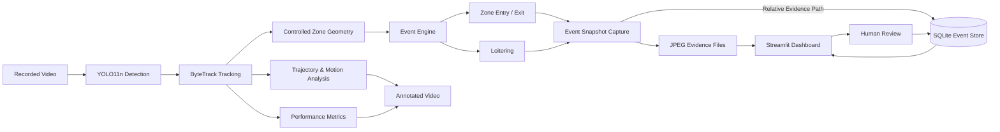

# GPU-Accelerated Video Analytics & Event Detection

[](https://github.com/zelihakb/edge-situational-awareness/actions/workflows/tests.yml)

A GPU-accelerated computer vision pipeline for object detection, persistent multi-object tracking, region-based event detection, event persistence, and human-in-the-loop review.

The project uses lightweight local inference and is designed with edge-oriented deployment constraints in mind, while current development and benchmarking are performed on a laptop GPU.

The system focuses on **observable behavior rather than identity or automated intent classification**.

---

## Features

- YOLO11n object detection
- ByteTrack persistent multi-object tracking
- People and vehicle detection
- Track trajectory visualization
- Resolution-independent controlled zone
- JSON-based controlled-zone configuration
- Interactive polygon editor with mouse-based vertex selection
- Polygon validation for invalid and self-intersecting shapes
- Bottom-center zone membership estimation
- Debounced zone entry and exit detection
- Loitering detection based on video time
- Zone-boundary-relative motion direction estimation
- Inside-zone motion classification
- Motion stability and boundary-direction regression tests
- SQLite event persistence
- Event-frame JPEG snapshot capture
- Event evidence path persistence in SQLite
- Human-in-the-loop review workflow
- Streamlit monitoring dashboard
- Event evidence viewer for human review
- Event filtering and CSV export
- Event timeline and review analytics
- Processed video preview
- FPS and latency benchmarking
- Automated core-logic tests

---

## Architecture



---

## Processing Pipeline

```text
VIDEO
  ↓
FRAME
  ↓
YOLO DETECTION
  ↓
BYTETRACK MULTI-OBJECT TRACKING
  ↓
  ├── TRAJECTORY / MOTION ANALYSIS
  │       ↓
  │   VIDEO ANNOTATION
  │
  └── CONTROLLED-ZONE GEOMETRY
          ↓
      EVENT ENGINE
          ↓
      ENTRY / EXIT / LOITERING
          ↓
  EVENT SNAPSHOT CAPTURE
          ↓
    JPEG EVIDENCE FILE
          ↓
    SQLITE EVENT STORAGE
    (WITH EVIDENCE PATH)
          ↓
      HUMAN-IN-THE-LOOP REVIEW
          ↓
      STREAMLIT DASHBOARD
```

---

## Event Types

### ZONE_ENTRY

Generated when a tracked object transitions from outside to inside the controlled zone.

A short temporal debounce is applied before confirming the transition to reduce boundary jitter.

### ZONE_EXIT

Generated when a tracked object transitions from inside to outside the controlled zone.

### LOITERING

Generated when a confirmed track remains inside the zone longer than the configured duration threshold.

Video timeline time is used instead of processing wall-clock time.

### Motion Direction — Zone-Relative Analysis (SP13)

Motion direction is estimated using recent bottom-center positions of tracked objects and their relationship to the controlled-zone polygon.

The current implementation distinguishes four motion states:

- `APPROACHING`: An object outside the zone moves closer to its boundary.
- `MOVING_AWAY`: An object outside the zone moves farther from its boundary.
- `MOVING_INSIDE`: An object inside the zone shows meaningful image-space displacement.
- `STABLE`: The measured motion change remains below the configured threshold, or insufficient history is available.

For objects outside the zone, the algorithm uses the signed Euclidean distance to the nearest polygon boundary, calculated with OpenCV's `pointPolygonTest`.

For objects inside the zone, displacement between the oldest and newest positions in a bounded history window is used instead of distance to the zone center.

This avoids interpreting movement through the zone center as movement away from the zone.

The implementation uses a configurable history length and motion threshold to reduce sensitivity to small coordinate fluctuations.

Motion states are experimental visualization signals, not persisted database events. Zone entry, exit, and loitering are evaluated separately.

The measurements represent image-space geometry rather than physical distance or velocity. The system does not infer an object's intent.

---

## Human-in-the-Loop Review

New observable events are stored with:

```text
review
```

status.

A human operator can update the event to:

```text
normal
confirmed
```

The review timestamp is persisted in SQLite.

The analytics pipeline does not perform identity recognition or automatically classify an individual's intent or threat level.

---

## Dashboard

The Streamlit dashboard provides:

- total event count
- pending review count
- confirmed event count
- normal event count
- event-type filtering
- review-status filtering
- object-class filtering
- editable review status
- event-type analytics
- human-review analytics
- event timeline
- CSV export
- processed video preview
- event-specific JPEG evidence viewer
- graceful handling of missing or legacy evidence

Run the dashboard with:

```powershell
streamlit run src\dashboard.py
```

---

## Project Structure

```text
edge-situational-awareness/
│── configs/
│   └── zone.json
│
├── data/
│   ├── input/
│   └── output/
│
├── src/
│   ├── config.py
│   ├── dashboard.py
│   ├── detect_image.py
│   ├── evidence.py
│   ├── events.py
│   ├── evaluation.py
│   ├── metrics.py
│   ├── review_event.py
│   ├── replay_events.py
│   ├── run_manifest.py
│   ├── storage.py
│   ├── track_video.py
│   ├── video_io.py
│   ├── visualization.py
│   ├── zone_editor.py
│   └── zone.py
│
├── tests/
│   ├── test_events.py
│   ├── test_storage.py
│   ├── test_zone.py
│   ├── test_evidence.py
│   ├── test_evaluation.py
│   ├── test_replay.py
│   ├── test_motion.py
│   ├── test_run_manifest.py
│   ├── test_run_integration.py
│   └── fixtures/
│       ├── sample_tracks.jsonl
│       └── expected_events.json
│── .github/
│   └── workflows/
│       └── tests.yml
├── .gitignore
├── README.md
├── requirements.txt
└── requirements-dev.txt
```

---

## Tech Stack

- Python
- Ultralytics YOLO11
- PyTorch
- CUDA
- OpenCV
- ByteTrack
- NumPy
- SQLite
- Pandas
- Streamlit
- Plotly
- FFmpeg
- pytest
- pytest-cov

Development GPU:

```text
NVIDIA GeForce RTX 3050 Ti Laptop GPU
```

---

## Dependency Licensing

This project uses Ultralytics YOLO.

Ultralytics provides its open-source software and YOLO models under the AGPL-3.0 license by default, with separate licensing options available for proprietary or commercial use.

Users intending to reuse or deploy this project should review the applicable Ultralytics licensing terms for their use case.

---

## Running the Project

### 1. Create and activate a virtual environment

Create the environment:

```bash
python -m venv .venv
```

Activate it on your operating system:

**Windows PowerShell**

```powershell
.\.venv\Scripts\Activate.ps1
```

**Linux / macOS**

```bash
source .venv/bin/activate
```

### 2. Install dependencies

For normal project use:

```powershell
python -m pip install -r requirements.txt
```

For development and automated testing:

```powershell
python -m pip install -r requirements-dev.txt
```

For GPU acceleration, install the appropriate CUDA-enabled PyTorch build for the local system.

### 3. Add an input video

The current demonstration configuration expects:

```text
data/input/intersection_v2.mp4
```

Input and generated video files are excluded from Git. Users must provide their own compatible video and update `INPUT_VIDEO` in `src/config.py` if necessary.

#### Interactive Zone Configuration (SP14)

The controlled zone can be configured visually without modifying Python source code.

Open the interactive zone editor:

```powershell
python src/zone_editor.py
```

The editor displays the first frame of the configured input video and loads the currently saved polygon.

**Editor controls:**

- **Left click:** Add a polygon vertex
- **C:** Clear all vertices
- **U:** Undo the last vertex
- **S:** Validate and save the polygon
- **Q / ESC:** Exit without saving

The editor stores normalized coordinates in `configs/zone.json`, allowing the polygon to be scaled to the input video's resolution.

Example configuration:

```json
{
  "name": "CONTROLLED_ZONE",
  "normalized_points": [
    [0.3, 0.55],
    [0.7, 0.55],
    [0.85, 0.92],
    [0.15, 0.92]
  ]
}
```

The video pipeline automatically loads and validates this configuration before processing begins.

Invalid coordinates, duplicate vertices, degenerate polygons, and self-intersecting polygon edges are rejected.

The current implementation supports one controlled zone. Vertex dragging and multiple-zone configuration are not yet available.

### 4. Run the analytics pipeline

```powershell
python src\track_video.py
```

The current configuration generates:

```text
data/output/tracked_intersection_v2.mp4
data/output/events_intersection_v2.db
data/output/evidence/run_<uuid>/*.jpg
data/output/evidence/run_<uuid>/manifest.json
```

Output paths are configurable in `src/config.py`.

### 5. Start the dashboard

```powershell
streamlit run src\dashboard.py
```

### 6. Run the automated tests

```powershell
python -m pytest -v
```

---

## Event Persistence

Events are stored in SQLite with fields including:

- event ID
- creation timestamp
- video timestamp
- frame number
- track ID
- object class
- detection confidence
- event type
- zone name
- loitering duration
- human review status
- review timestamp
- relative evidence image path

Example:

```text
Event ID:      5
Video time:    3.00 s
Track ID:      6
Class:         person
Confidence:    81.2%
Event:         LOITERING
Zone:          CONTROLLED_ZONE
Duration:      3.0 s
Review status: normal
```

The stored confidence value represents the detector confidence for the tracked object on the event frame. It is not an event-confidence score.

Event snapshots are stored as JPEG files in run-specific directories. SQLite stores the relative evidence path rather than the image itself.

Each processing run uses a unique directory to avoid overwriting snapshots from previous runs. Legacy event records remain accessible and may have a NULL evidence_path value.

---

## Performance Benchmarking

The pipeline records:

- YOLO inference latency
- Complete tracking-call latency
- End-to-end frame latency
- Rolling FPS
- Overall pipeline FPS

### SP13 Development Benchmark

A single development run was performed using a 1280 × 720 recorded video at 24 source FPS on an NVIDIA GeForce RTX 3050 Ti Laptop GPU.

```text
Processed frames              : 240 / 240
Overall pipeline FPS          : 15.78
Average inference latency     : 13.62 ms
Average track-call latency    : 21.19 ms
Average end-to-end latency    : 57.56 ms
Recorded events               : 18
```

The pipeline successfully processed the complete 10-second video and generated an H.264 MP4 output.

The 18 recorded events are pipeline outputs, not independently verified ground-truth detections.

Throughput was below the video's 24 FPS source rate. Therefore, this result does not establish real-time processing at the source frame rate.

Performance varies with GPU state, power mode, temperature, background processes, and workload.

These values represent a **single-run development benchmark**, not a universal or guaranteed real-time performance claim.

Repeated benchmark runs with mean and standard deviation, as well as formal event accuracy evaluation, remain future work.

---

## Automated Testing

Core deterministic logic is covered by automated `pytest` tests that run without requiring video inference or a GPU.

Current tests cover:

- normalized zone geometry and scaling
- inside / outside / boundary behavior
- initial track-state handling
- debounced zone entry and exit
- boundary-jitter cancellation
- video-time-based loitering
- repeated loitering prevention
- exit and re-entry behavior
- SQLite event persistence
- human review state transitions
- invalid review states
- lightweight database schema migration
- event snapshot creation and JPEG validation
- snapshot preservation across separate run directories
- SQLite evidence-path persistence
- snapshot-to-database path integration
- legacy event migration with NULL evidence paths
- signed distance to polygon boundaries
- stationary tracks and small tracking jitter
- inside-zone motion across the zone center
- zone-boundary-relative approaching and moving-away classification
- cases where zone-center and boundary-based motion estimates disagree
- JSON zone configuration loading and saving
- invalid polygon configuration rejection
- self-intersecting polygon rejection
- valid concave polygon acceptance
- precision, recall, and F1 metric calculations
- one-to-one temporal event matching with frame tolerance

Current test suite:

```text
72 tests passed
```

Previously measured deterministic core coverage (SP9 baseline; not recalculated for the current test suite):

```text
events.py   : 99%
storage.py  : 100%
zone.py     : 79%

Combined core coverage: 97%
```

The lower coverage in `zone.py` is primarily caused by OpenCV rendering operations, while deterministic geometry behavior is covered.

Repository-wide source coverage is currently lower because UI, video I/O, orchestration, and visualization modules are not yet covered by unit tests. Coverage is therefore reported separately for the deterministic core logic.

A golden replay integration test also replays 5,195 recorded observations from a real YOLO + ByteTrack run through the event engine and compares the resulting 20 events against a frozen expected-event fixture. This provides deterministic regression coverage for the tracker-to-event boundary without requiring the model, GPU, or source video in CI.

The replay fixture is a regression baseline rather than ground-truth accuracy evaluation.

Run the tests with:

```powershell
python -m pytest -v
```

Run core coverage with:

```powershell
python -m pytest --cov=src.events --cov=src.storage --cov=src.zone --cov-report=term-missing
```

SP13 adds six motion-related test cases covering stationary behavior, positional jitter, inside-zone movement, boundary-relative approach and departure, and a center-versus-boundary disagreement scenario.

### SP15 — Event Evaluation Infrastructure

SP15.1 introduces precision, recall, and F1 calculations
from true-positive, false-positive, and false-negative counts.

SP15.2 introduces one-to-one temporal event matching using
event types, frame numbers, and configurable frame tolerance.

The matcher maximizes the number of matches and minimizes
total timing differences among equally sized matches.

Current limitations:

- Matching is not object-identity aware.
- Independently annotated ground truth is not yet available.
- Reported metrics have not been validated on real video.

Ground-truth evaluation and failure analysis remain future work.

### Run Identification and Reproducibility (SP17)

Each video processing run receives a unique `run_id`.

Events are associated with that run through the SQLite `run_id`
column. Legacy events retain NULL run IDs.

A run-specific JSON manifest records the input video and model
SHA-256 hashes, video metadata, controlled-zone configuration,
and relevant processing settings.

The manifest is saved alongside the run's JPEG evidence files.

This enables historical processing runs to be inspected without
relying on the current zone configuration.

Processed MP4 output currently uses a fixed destination and may
be overwritten by subsequent runs. The run manifest does not
preserve a separate copy of that video.

### Evaluation Input Validation (SP18)

Evaluation functions validate event records before matching.

Each event must contain:

- A non-empty `event_type` string.
- A non-negative integer `frame_number`.

Ground truth and prediction inputs must be lists of event
dictionaries. Invalid inputs raise a descriptive `ValueError`.

Event counts must be non-negative integers. Boolean values
and floating-point counts are rejected.

Empty event collections are supported. Undefined precision,
recall, and F1 ratios are reported as `0.0`.

These validation rules help prevent malformed annotations
from producing misleading evaluation results.

---

## Design Decisions

### Bottom-center zone membership

Zone membership is determined using the bottom-center of each tracked bounding box as an approximation of ground contact.

This is generally more suitable for ground-plane zones than using the center of the entire bounding box.

### Temporal debounce

Zone transitions must remain stable for multiple frames before generating an entry or exit event.

This reduces false transitions caused by bounding-box jitter around polygon boundaries.

### Initial observation semantics

A track's first observation establishes its current zone state without generating an artificial entry or exit event.

For example, if a track is first observed inside the zone, the system does not claim that it observed the object entering.

### Video-time loitering

Loitering duration is calculated using:

```text
frame difference / source FPS
```

instead of processing wall-clock time.

This prevents runtime performance fluctuations from changing the semantic duration of an event in recorded video.

### Observable-event design

The system identifies observable events such as:

- entering a controlled area
- leaving a controlled area
- remaining inside for a configured duration
- image-space movement relative to a zone

Human operators remain responsible for interpretation and review.

### Separation of event logic and persistence

The event engine produces structured events without directly writing to the database.

Persistence is handled separately by the storage layer, keeping event logic easier to test and reason about.

---

## Limitations

- Motion estimation currently operates in image space rather than calibrated world coordinates.
- Boundary-relative motion does not measure physical distance or real-world speed.
- Movement parallel to the zone boundary may be classified as STABLE when signed boundary distance changes very little.
- Inside-zone motion uses net displacement across a history window and may miss movement that returns near its starting position.
- Motion labels may be affected by occlusion, tracking jitter, and camera perspective.
- Motion classifications have not yet undergone formal ground-truth accuracy evaluation.
- No homography, camera calibration, or physical distance estimation is currently applied.
- The controlled zone is currently configuration-based and designed around a single demonstration region.
- Tracking IDs may change under heavy occlusion or difficult scenes.
- Detection uses a pretrained general-purpose COCO model rather than a domain-specific model.
- Detection confidence represents the model prediction for the object on the event frame, not confidence in the event itself.
- Current development testing primarily uses recorded video.
- Current performance results are based on individual development runs and can vary substantially between runs.
- Formal event precision / recall evaluation has not yet been completed.
- Repository-wide automated coverage does not yet include the complete UI, video I/O, and orchestration stack.
- The project does not perform face recognition or identity inference.
- Dedicated edge-hardware deployment has not yet been evaluated.
- Event snapshots capture individual annotated frames and do not independently establish temporal event correctness.
- The event-specific object is not yet visually highlighted separately from other detections.
- Legacy events may not have associated evidence images.
- Snapshot capture introduces additional disk I/O, but its isolated performance impact has not yet been benchmarked.

---

## Ethics and Safety

The project is intentionally designed around **observable event detection and human review**.

It does not perform:

- face or biometric recognition
- identity inference
- automated classification of a person's intent or threat level
- autonomous targeting
- autonomous enforcement decisions

The system reports measurable visual events and leaves contextual interpretation to a human operator.

---

## Roadmap

Development is currently focused on **verification and evaluation before additional feature expansion**.

### Completed — SP13

- Zone-boundary-relative motion analysis
- Inside-zone motion classification
- Motion regression tests
- Video pipeline integration and visual validation

### Completed — SP14

- JSON-based zone configuration
- Interactive mouse-based polygon editor
- Zone configuration integration with the video pipeline
- Polygon validation and regression tests

### Planned work

- small ground-truth event evaluation
- precision / recall and timing-error analysis
- documented failure-case analysis
- repeated performance benchmarks with mean and standard deviation
- configurable multiple zones
- live webcam input
- ONNX Runtime benchmarking

### Optional later extensions

- minimal FastAPI service layer
- CPU-oriented Docker packaging
- RTSP / network-stream input
- dedicated edge-hardware evaluation

---

## Status

Active portfolio project.

Current milestone includes:

```text
Detection
Tracking
Trajectory analysis
Controlled-zone monitoring
Entry / exit events
Loitering
Zone-relative motion direction (SP13, experimental)
SQLite persistence
Human review
Interactive dashboard
Event-frame JPEG snapshots
SQLite evidence path persistence
Dashboard evidence viewer
Performance benchmarking
Automated core-logic tests
Golden replay regression testing
GitHub Actions CI
```

Current automated test suite: **72 passing tests**.

The current development phase is focused on testing, validation, evaluation, and failure analysis before adding further system complexity.
